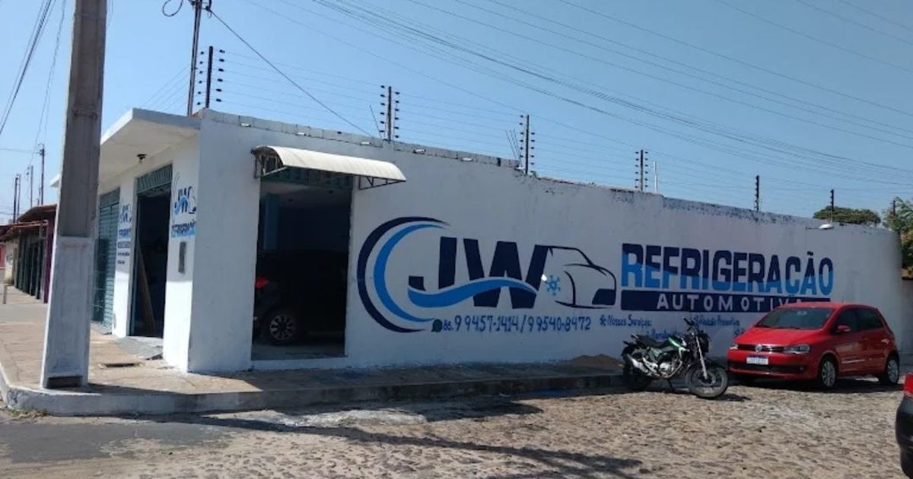

# JW Refrigeração Automotiva — Site institucional

Site da **JW Refrigeração Automotiva**, oficina especializada em ar-condicionado automotivo em Parnaíba-PI. A página apresenta os serviços, mostra fotos da oficina e leva o visitante direto para um orçamento pelo WhatsApp.



## Funcionalidades

- **Hero em 3D**: um floco de gelo animado com partículas de "ar frio", feito em WebGL (Three.js), que reage ao movimento do mouse.
- **Orçamento pelo WhatsApp**: um formulário curto (nome, carro, serviço) que monta a mensagem pronta e abre a conversa com a oficina.
- **Seções**: serviços, sinais de que o ar precisa de manutenção, galeria com lightbox, diferenciais e contato com link para o Google Maps.
- **Animações de entrada**: elementos aparecem conforme a rolagem, os números sobem sozinhos e os cards inclinam em 3D sob o cursor.
- **Responsivo**: layout adaptado para celular, tablet e desktop.
- **Acessível a quem prefere menos movimento**: com `prefers-reduced-motion` ativo, as animações são desligadas e a cena 3D nem é carregada.

## Tecnologias

- HTML, CSS e JavaScript puros, sem framework e sem etapa de build
- [Three.js](https://threejs.org/) r128 para a cena 3D
- Fontes Unbounded e Manrope (hospedadas no próprio site)
- Hospedagem na [Vercel](https://vercel.com/)

## Performance

O site foi otimizado para carregar rápido mesmo em conexões móveis:

- Imagens em **WebP** com `srcset` responsivo (640px e 1080px) e carregamento sob demanda (`loading="lazy"`)
- **Three.js carregado só depois** que a página termina de abrir, sem bloquear a primeira renderização
- Partículas animadas na **GPU** (vertex shader), sem atualizar buffers na CPU a cada frame
- Animação 3D **pausada** quando o topo sai da tela ou a aba fica em segundo plano
- Fontes e scripts servidos pelo próprio domínio, com **cache de 1 ano**
- `content-visibility` nas seções abaixo da dobra, para o navegador não renderizar o que ainda não está visível
- Metadados de SEO, Open Graph (prévia ao compartilhar o link) e dados estruturados `AutoRepair` (schema.org)

## Estrutura

```
.
├── index.html        # página única (HTML, CSS e JS inline)
├── img/              # fotos em WebP, ícones e imagem de compartilhamento
├── fonts/            # fontes em WOFF2
├── vendor/           # three.min.js
├── vercel.json       # cabeçalhos de cache e segurança
└── .vercelignore     # arquivos que não sobem no deploy (fotos originais)
```

## Rodando localmente

Por ser um site estático, basta servir a pasta com qualquer servidor HTTP:

```bash
# com Python
python -m http.server 8000

# ou com Node
npx serve .
```

Depois é só abrir `http://localhost:8000`.

> Abrir o `index.html` direto pelo explorador de arquivos (`file://`) pode impedir o carregamento das fontes e do Three.js. Prefira um servidor local.

## Deploy

O projeto está pronto para a Vercel, sem nenhuma configuração extra:

```bash
npx vercel --prod
```

Também é possível importar este repositório no painel da Vercel. A cada `push` na branch principal, o site é publicado automaticamente.

## Contato da oficina

- **WhatsApp:** (86) 99457-1414
- **Endereço:** Av. Dr. João Silva Filho, quadra A, casa 13 — Frei Higino, Parnaíba-PI
- **Instagram:** [@jw_refrigeracao_automotiva_phb](https://www.instagram.com/jw_refrigeracao_automotiva_phb/)

---

Desenvolvido por **Nathan Almeida**.
